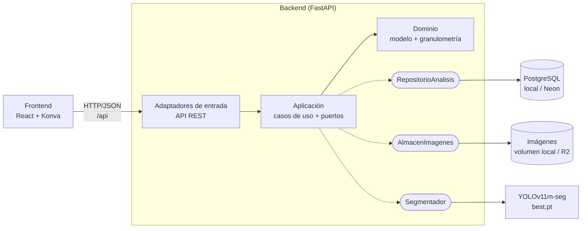

# Sistema de Detección y Análisis Granulométrico de Roca mediante IA

[](#)
[](#)
[](#)
[](#)
[](#)
[](#)
[](#)
[](#)
[](#)
[](#)
[](#)
[](#)

Aplicación web para analizar la fragmentación de roca producida por una voladura a partir de una fotografía. El operador carga la foto de la pila, calibra la escala con un objeto de dimensión conocida, obtiene una segmentación automática de los fragmentos con un modelo **YOLO** de segmentación de instancias, corrige el resultado con herramientas de edición y recibe la distribución granulométrica: **D20, D50, D60, D80, D90**, índice de uniformidad **n** (Rosin-Rammler), curva granulométrica e histograma.

Proyecto de la asignatura **Trabajo de Campo**, Ingeniería de Sistemas y Computación, **Universidad Pedagógica y Tecnológica de Colombia (UPTC)**, Seccional Sogamoso.

---

## Equipo

| Persona | Rol |
| :--- | :--- |
| **Camilo Galindo** | Product Owner · Backend · responsable del repositorio |
| **Daniela Guevara** | Scrum Master · Componente de IA |
| **Bibian Corredor** | Frontend · Líder de pruebas |
| Ing. Dr. Fabián Andrés Medina Becerra | Docente y director |
| Ing. Cristian Camilo Suancha | Asesor en IA |
| Ing. Wilder Ocampo Ochoa | Cliente ("el operador"), ingeniero de minas |

---

## Estado del proyecto

| Funcionalidad | Estado |
| :--- | :--- |
| Crear análisis subiendo una foto (JPG/PNG) | ✅ |
| Listar, buscar, filtrar y eliminar análisis | ✅ |
| Calibrar la escala trazando una línea sobre el objeto de referencia | ✅ |
| Marcar y quitar la región del objeto de escala (se excluye del conteo) | ✅ |
| Reanudar el análisis al recargar la página | ✅ |
| Almacenamiento en la nube (Neon + Cloudflare R2) por configuración | ✅ |
| Segmentación automática con YOLO (requiere `backend/modelos/best.pt`) | ✅ |
| Editor de fragmentos: borrar, dibujar, unir, dividir y deshacer | ✅ |
| Resultados: Dx, n, curva, histograma y colores por rango | ✅ |
| Informe PDF (desde el navegador) e historial de análisis | ✅ |
| Exportación a CSV | ⏳ Sprint 4 |
| Usuarios con roles | Complementario |

---

## Tecnologías utilizadas

* **Backend:**
    * Python 3.12 + FastAPI + Uvicorn
    * SQLAlchemy 2 (tablas separadas del dominio) + Alembic (migraciones automáticas al arrancar)
    * Pydantic v2 + pydantic-settings
    * Pillow (detección del formato de imagen por contenido)
    * boto3 (Cloudflare R2, compatible con S3)
    * Ultralytics YOLOv11m-seg (torch solo CPU dentro de Docker)
    * pytest + ruff · pruebas de S3 con moto
* **Frontend:**
    * React 18 + TypeScript estricto + Vite
    * react-konva (lienzo para calibración y edición de polígonos)
    * vitest + Testing Library
    * Estilo solo con tokens CSS (`src/tema/tokens.css`)
* **Base de datos y archivos:**
    * PostgreSQL 16 (local en Docker o **Neon** en la nube)
    * Imágenes fuera de la base de datos: volumen local o bucket privado de **Cloudflare R2**
* **Infraestructura:**
    * Docker Compose con 3 servicios: `db`, `backend` y `frontend` (nginx)
    * Solo se expone el puerto **80**; nginx envía `/api` al backend

---

## Arquitectura

Monolito modular con **arquitectura hexagonal** (puertos y adaptadores). El dominio no conoce ni la base de datos, ni el almacén de imágenes, ni el modelo de IA: todo eso se conecta por puertos, y cambiar un adaptador (por ejemplo, disco local por R2, o un modelo por otro) no toca el resto del sistema.



Reglas que vigila una prueba automática (`tests/unit/test_arquitectura.py`):

* `dominio/` importa **solo** la biblioteca estándar de Python.
* `aplicacion/` nunca importa adaptadores.
* `main.py` es el **único** lugar donde se crean los adaptadores reales.

El detalle está en [`docs/arquitectura.md`](docs/arquitectura.md), [`docs/dominio.md`](docs/dominio.md) y [`docs/api.md`](docs/api.md).

---

## Instalación y ejecución

### Requisitos previos

* **Docker Desktop** con Docker Compose v2 (abierto antes de ejecutar los comandos)
* **Git**
* **Node.js 20** y npm *(solo para correr las pruebas del frontend fuera de Docker)*
* **Python 3.12** *(solo para correr las pruebas del backend fuera de Docker)*
* Puerto **80** libre

> Los comandos están escritos para **PowerShell** (Windows). En macOS o Linux, cambia `Copy-Item origen destino` por `cp origen destino`.

### 1. Clonar el repositorio

```powershell
git clone https://github.com/Cristian13Galindo/analisis_rocas.git
cd analisis_rocas
```

### 2. Crear el archivo de entorno local

```powershell
Copy-Item .env.example .env
```

Los valores por defecto de `.env.example` sirven tal cual para trabajar en local. **No hace falta editar nada.**

### 3. Levantar el sistema

```powershell
docker compose up --build
```

La primera vez tarda varios minutos (descarga imágenes e instala dependencias). Está listo cuando el log del backend muestra:

```
backend-1  | INFO:     Uvicorn running on http://0.0.0.0:8000
```

### 3.1 (Opcional) Copiar el modelo de IA

Copia `best.pt` (Drive del equipo, ver `docs/ia.md`) a `backend/modelos/best.pt` antes de `docker compose up --build`. Sin ese archivo la aplicación arranca igual, pero el botón **Segmentar con IA** responde que el modelo no está disponible; los fragmentos se pueden dibujar a mano.

### 4. Usar el sistema

| Servicio | URL |
| :--- | :--- |
| **Aplicación** | `http://localhost` |
| **Documentación de la API (Swagger)** | `http://localhost/api/docs` |
| **Salud del backend** | `http://localhost/api/salud` |

### 5. Detener el sistema

`Ctrl + C` en la terminal y luego:

```powershell
docker compose down
```

Los datos locales se conservan en los volúmenes de Docker (`pgdata` e `imagenes`).

---

## Modo local y modo nube

El sistema puede trabajar contra dos destinos. **Solo cambia el archivo `.env`; el código es el mismo.**

| | Modo local (por defecto) | Modo nube |
| :--- | :--- | :--- |
| Archivo de configuración | `.env` copiado de `.env.example` | `.env.nube` (lo entrega Camilo por privado) |
| Base de datos | PostgreSQL en el contenedor `db` | **Neon** (compartida por todo el equipo) |
| Imágenes | Volumen local `imagenes` | Bucket privado de **Cloudflare R2** (compartido) |
| ¿Para qué se usa? | **Desarrollar, modificar código y correr pruebas** | Ver y probar los datos compartidos del equipo, demos con el Ing. Wilder |
| ¿Puedo borrar cosas? | Sí, solo afecta tu equipo | ⚠️ Lo que borres desaparece **para todas** |

### Cómo pasar a modo nube

1. Guarda el archivo `.env.nube` que te enviaron en la **raíz del repositorio** (al lado de `.env.example`). Git lo ignora: nunca se sube.
2. Respalda tu `.env` local **fuera** del repositorio y activa la nube:

```powershell
Copy-Item .env ..\env-local-respaldo.txt
Copy-Item .env.nube .env
docker compose down
docker compose up --build
```

3. Abre `http://localhost`. Ahora ves los análisis compartidos. La lista local y la de la nube son distintas: si la ves vacía o diferente, es normal.

### Cómo volver a modo local

```powershell
Copy-Item ..\env-local-respaldo.txt .env
docker compose down
docker compose up --build
```

> La base de Neon se suspende tras unos minutos sin uso. La **primera** petición después de una pausa puede tardar unos segundos más; las siguientes son normales.

---

## Pruebas

### Backend

```powershell
cd backend
python -m venv .venv
.\.venv\Scripts\Activate.ps1
pip install -e ".[dev]"
pytest
ruff check .
```

* Sin la variable `TEST_DATABASE_URL`, las pruebas de integración con PostgreSQL **se omiten** y el resto corre igual.
* Para correrlas todas, apunta `TEST_DATABASE_URL` a un PostgreSQL **local y desechable**.

> ⛔ **Nunca** pongas en `TEST_DATABASE_URL` la base de Neon. Las pruebas crean y borran datos: dañarían la base compartida.

### Frontend

```powershell
cd frontend
npm install
npm test
```

---

## Cómo trabajamos

* **Tareas:** cada cambio se describe en `docs/tareas/T-XXX.md` y se cierra con un reporte en `docs/reportes/T-XXX.md` (plantilla en `docs/reportes/PLANTILLA.md`).
* **Desarrollo guiado por pruebas (TDD):** primero la prueba, luego el código.
* **Nombres en español sin tildes** en código (`calibrar_escala`, `RepositorioAnalisis`).
* **La fuente de verdad** es `CLAUDE.md` + la carpeta `docs/`. Si algo no coincide, prevalece `docs/`.
* **Ramas:** cada tarea en su propia rama (`tarea/T-XXX-descripcion-corta`) y se integra a `main` mediante *pull request* que revisa Camilo. Nadie hace *push* directo a `main`.

```powershell
git checkout main
git pull
git checkout -b tarea/T-008-editor-poligonos
# ... cambios, pruebas en verde ...
git add <archivos>
git commit -m "feat(frontend): herramienta de borrar fragmentos"
git push -u origin tarea/T-008-editor-poligonos
# Abrir el pull request en GitHub
```

* **Commits** con el formato `tipo(alcance): descripción` → `feat`, `fix`, `docs`, `test`, `chore`.

---

## Estructura del proyecto

```text
analisis_rocas/
│
├── backend/
│   ├── Dockerfile
│   ├── entrypoint.sh               # alembic upgrade head + uvicorn
│   ├── pyproject.toml              # Dependencias (y extras de desarrollo)
│   ├── alembic.ini
│   ├── alembic/versions/           # Migraciones (0001_tablas_iniciales)
│   ├── modelos/                    # best.pt de YOLO (no se versiona)
│   ├── tests/
│   │   ├── unit/                   # Dominio, casos de uso, arquitectura
│   │   └── integracion/            # API, PostgreSQL, almacén S3 (moto)
│   └── app/
│       ├── main.py                 # Raíz de composición: crea los adaptadores
│       ├── config.py               # Variables de entorno
│       ├── dominio/                # Modelo, granulometría y errores (solo stdlib)
│       ├── aplicacion/             # Casos de uso y puertos
│       └── adaptadores/
│           ├── entrada/            # API REST
│           └── salida/             # Persistencia, almacenamiento, imágenes, segmentación
│
├── frontend/
│   ├── Dockerfile
│   ├── nginx.conf                  # Sirve el build y envía /api al backend
│   └── src/
│       ├── api/                    # Cliente tipado y traducción de errores
│       ├── componentes/            # UI compartida
│       ├── editor/                 # Lienzo Konva y geometría (funciones puras)
│       ├── pantallas/              # Mis análisis, Nuevo análisis, Calibrar
│       └── tema/                   # tokens.css
│
├── docs/
│   ├── arquitectura.md · dominio.md · api.md · requisitos.md
│   ├── tareas/                     # Enunciados T-XXX
│   └── reportes/                   # Reportes T-XXX
│
├── CLAUDE.md                       # Guía de trabajo del repositorio
├── docker-compose.yml
├── docker-compose.override.example.yml   # Expone 8000 y 5432 en desarrollo
├── .env.example                    # Configuración local
└── .env.nube.example               # Plantilla de la configuración de nube
```

---

## Seguridad: reglas del equipo

* `.env` y `.env.nube` **nunca** se suben a git ni se pegan en chats, correos, capturas o asistentes de IA.
* El `.env.nube` da acceso total a la base compartida y al bucket de imágenes. Guárdalo solo en tu equipo.
* Si crees que un `.env.nube` se filtró, avisa a Camilo de inmediato para rotar las credenciales.
* **No subas archivos a mano al bucket de R2:** las claves de las imágenes las genera el sistema.
* Los pesos del modelo (`best.pt`) no se versionan.

---

## Solución de problemas comunes

| Problema | Causa probable | Solución |
| :--- | :--- | :--- |
| `docker compose` no responde o da error de conexión | Docker Desktop no está abierto | Abre Docker Desktop y espera a que diga *running* |
| No carga `http://localhost` | El puerto 80 está ocupado por otro programa | Cierra el programa (IIS, Skype, otro servidor) o revisa `docker compose ps` |
| `ValueError: Invalid endpoint: https://ACCOUNT_ID...` | El `.env` tiene marcadores de la plantilla sin reemplazar | Usa el `.env.nube` real que te enviaron, no el `.env.nube.example` |
| El backend se detiene con un error de configuración S3 | Falta una variable `S3_*` con `ALMACEN_IMAGENES=s3` | Revisa que el `.env` tenga las cuatro variables `S3_*` completas |
| La lista de análisis aparece vacía | Cambiaste entre modo local y nube | Es normal: cada modo tiene su propia base de datos |
| Error `413` al subir una foto | El archivo pesa más de 20 MB | Reduce el tamaño de la foto |
| Error `415` al subir una foto | El archivo no es JPG ni PNG | Convierte la imagen a JPG o PNG |
| Error `409 ESCALA_NO_CALIBRADA` | Se intentó segmentar sin calibrar | Calibra la escala primero |
| El backend se reinicia o se cae | Error al arrancar | Revisa `docker compose logs backend` y comparte **solo** la línea del error (sin secretos) |

---

## Alcance y limitaciones declaradas

* Solo imágenes estáticas 2D (JPG/PNG). Sin video, 3D, LiDAR ni drones.
* La calibración de escala es manual.
* Supuestos del cálculo: forma esférica de los fragmentos, finos no visibles y superficie 2D. El sistema **no reemplaza el tamizado**.

---

## Licencia

Proyecto académico de la UPTC. Licencia: **[por definir]**.

> El modelo YOLO de Ultralytics se distribuye bajo **AGPL-3.0**, que obliga a publicar el código de cualquier producto derivado que se distribuya. No afecta el uso académico.
>
> ---

## Proyección

<p align="center">
  <a href="https://minisiteg.com">
    
  </a>
</p>

Este sistema nace como proyecto académico de la UPTC. Una vez finalizado, se proyecta su evolución hacia un producto profesional de **MiniSiteᵍ**, orientado a operaciones mineras de pequeña y mediana escala.

**Equipo de desarrollo:** Cristian Camilo Galindo Suárez
